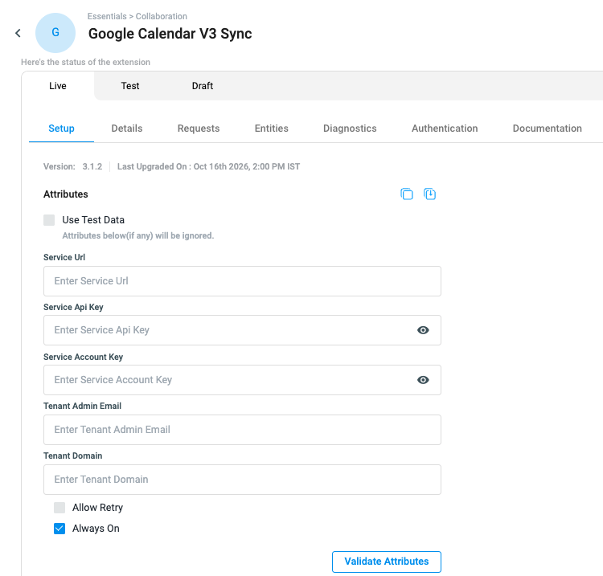
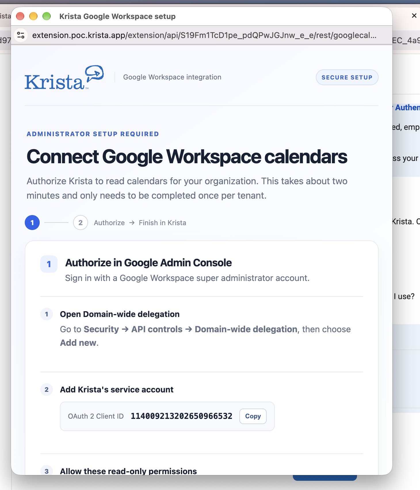
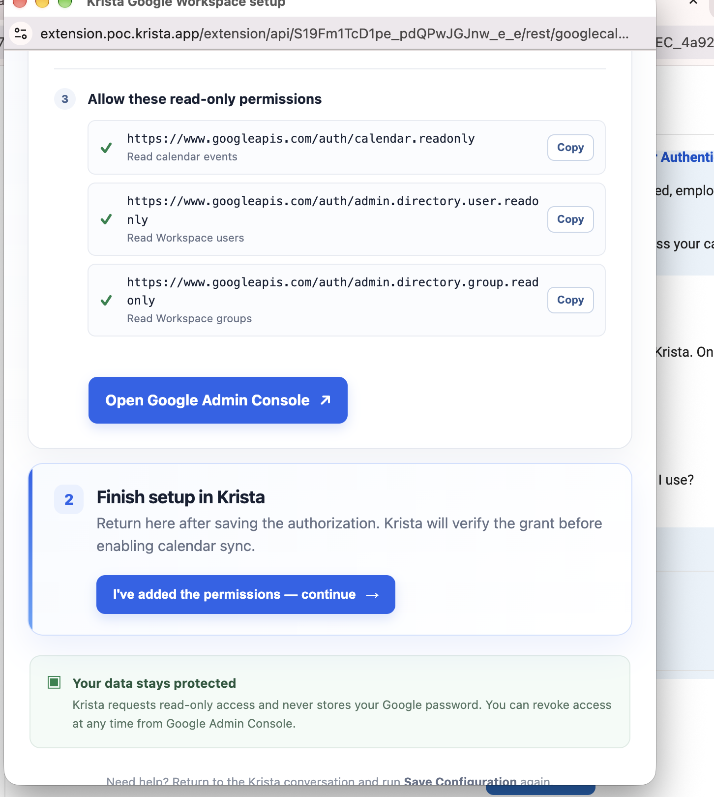

# Google Calendar Always On — Setup Guide

This guide covers administrator setup for Google Calendar V3 Sync, including the updated
**Setup** page. Always On reads calendars for **active, licensed Meeting Agent users whose email
addresses match active Google Workspace accounts**. It does not scan every account in the domain.
Meeting templates still control how eligible meetings are captured and processed.

For eligibility and Google Groups, see [Always On — Registered Meeting Agent Users](pages/AlwaysOnRegisteredUsers.md).

## Before you begin

- Have Google Workspace **super administrator** access for delegation approval and Krista workspace
  administrator access to configure the extension.
- Have permission to create a Google Cloud service account and JSON key, or obtain an approved key
  from your administrator.
- Have the **CA service base URL** and service API key for the correct environment.
- Register and license at least one active Meeting Agent user whose email matches an active
  Google Workspace account.

Always On replaces the individually connected calendar scan set; it does not merge both sets, and
personal sign-ins are never used while it is on — not even when delegated access fails.
Review [who stops being captured](pages/AlwaysOnRegisteredUsers.md#important-who-stops-being-captured)
before enabling it. Personal Google accounts and users without an active licensed seat are not
included in delegated discovery.

## Step 1 — Prepare the Google service account

1. Open [Google Cloud Console](https://console.cloud.google.com/) and select the integration's project.
2. Under **APIs & Services > Library**, enable **Google Calendar API** and **Admin SDK API**.
3. Open **IAM & Admin > Service Accounts**. Create a dedicated service account or select the approved
   existing account. Do not grant broad project roles just to read Workspace calendars.
4. Open **Keys > Add key > Create new key**, select **JSON**, and download the file. If your
   organization blocks key creation, ask your administrator for the approved provisioning process.
5. Record the numeric **OAuth Client ID**, available in the service account's details or Advanced
   settings and as `client_id` in its JSON key. Do not substitute `private_key_id`, the project ID,
   or the service account email.

Protect the JSON file: it contains a private key. Keep it in approved secure storage and never paste
it into chat, tickets, or screenshots. Enter its full contents only in the secured
**Service Account Key** field.

## Step 2 — Open the updated extension Setup page

1. In Krista Studio, open the **Google Calendar V3 Sync** extension used by your Meeting Agent workspace.
2. Select the appropriate environment tab and open **Setup**. For production, use **Live** and leave
   **Use Test Data** unchecked.
3. Complete the fields below and select **Always On**.



*Updated Setup page. Use values for your own environment; the screenshot is a reference.*

| Setup field | What to enter |
|---|---|
| **Service Url** | The CA service base URL, such as `https://<ca-host>`. Do not use the extension routing URL. |
| **Service Api Key** | A valid CA service API key authorized for the integration. This is a secured field. |
| **Service Account Key** | The entire service account JSON key, unchanged, including the opening and closing braces. This is a secured field. |
| **Tenant Admin Email** | A Workspace administrator identity able to list Directory users and read its primary calendar for validation. |
| **Tenant Domain** | Optional. A domain such as `yourcompany.com`, not a URL or email address. Blank discovers users across the Workspace customer account. |
| **Allow Retry** | Keep your existing setting. It controls catalog validation retries, not delegated access. |
| **Always On** | Select to enable registered-user discovery through delegated access. Off by default. |

Individual sign-in OAuth client credentials are **not** substitutes for the service account JSON
key and are not additional fields on this Setup page.

## Step 3 — Validate and save in Krista

1. Select **Validate Attributes**. When both delegation credentials are present, Krista checks
   Directory user access and access to the administrator's primary calendar.
2. Where setup is driven by a conversation, run **Save Configuration Google Calendar**. Saved
   attributes are reused; provide any requested missing values.
3. If administrator authorization is required, open the setup link presented by Krista. Keep the
   original conversation and setup window open while completing the next steps.
4. If the Google grant is already valid, the authorization window may not appear. Complete saving
   and proceed to Step 6.

Selecting Always On alone is **not proof of delegated access**. Studio can save the checkbox with
credentials missing; background discovery then scans no calendars at all (personal sign-ins are not
used as a fallback). Complete
the key and administrator email, then verify the effective discovery mode in Step 6.

### Recognize the administrator setup window

The window shows the service account Client ID and authorization steps. Copy the ID from your
**current** setup window: the number and URL in this screenshot are examples, not universal values.



## Step 4 — Authorize access in Google Admin Console

Use a Workspace **super administrator** account. This is domain-wide delegation approval, not an
individual user's Google consent screen.

1. Select **Open Google Admin Console** in the setup window or open [Google Admin Console](https://admin.google.com/).
2. Go to **Security > Access and data control > API controls > Manage Domain Wide Delegation**.
3. Select **Add new** and paste the numeric **OAuth Client ID** from the current setup window.
   It must match `client_id` in your service account JSON key.
4. In **OAuth Scopes**, enter these three read-only URLs, separated by commas:

   ```text
   https://www.googleapis.com/auth/calendar.readonly,https://www.googleapis.com/auth/admin.directory.user.readonly,https://www.googleapis.com/auth/admin.directory.group.readonly
   ```

5. Select **Authorize**. If multi-party approval is required, have another super administrator
   approve the request.
6. Open **View details** and confirm all three scopes are listed. If the Client ID already has an
   entry, edit it instead of creating a duplicate.

| Scope | Purpose |
|---|---|
| `calendar.readonly` | Reads events and establishes calendar change-notification watches. |
| `admin.directory.user.readonly` | Confirms registered users are active Workspace directory accounts. |
| `admin.directory.group.readonly` | Reads Google Groups and membership to expand group invitations into attendees. |

Existing installations with only the first two scopes should **add the group scope to the same
entry**. Without it, calendar discovery can still work, but group expansion is skipped. Initial
validation checks Calendar and Directory user access, not group expansion.

Google notes delegation changes can take up to **24 hours** to propagate, although they usually take
effect sooner. If verification is rejected, check the Client ID and exact scope strings, then retry
after propagation. Do not replace these with broader write-access scopes.

## Step 5 — Return to Krista and finish setup

1. After saving the Google grant, return to the **original** Krista setup window.
2. Under **Finish setup in Krista**, select **I've added the permissions — continue**.
3. Return to the conversation and wait for validation and saving to finish. Confirm the response
   says **saved successfully**; clicking Continue alone does not prove Google accepted the grant.



The setup link expires after **2 hours**, and continuation is single-use. For an expired or already
used link, run **Save Configuration Google Calendar** again. Do not reuse a link from another session
or invoker.

## Step 6 — Verify Always On and test a calendar

### Confirm the saved configuration

Reopen **Setup** and confirm Always On remains selected and the correct CA URL, secured credentials,
administrator email, and optional domain are retained. Do not copy secured values into tickets.
Saving initiates registered-user watch reconciliation in the background.

### Check the effective discovery mode

In the extension's **Diagnostics** log view, search for `[GCAL-DISCOVERY]`. Successful delegated
discovery reports `mode=ENROLLED_USERS` and `alwaysOn=true`. Example counts below are illustrative:

```text
[GCAL-DISCOVERY] ... mode=ENROLLED_USERS users=2 seats=2 seatsNotInDirectory=0 alwaysOn=true
```

| Log value | How to read it |
|---|---|
| `users` / `seats` | Eligible Google accounts being scanned / active, licensed Meeting Agent roster. |
| `seatsNotInDirectory` | Registered seats Google did not confirm as active accounts. Check email addresses and Tenant Domain. |
| `users=0 ... degraded=true` | Delegated discovery could not run for that scan, so **no** calendar was scanned. Read the reason; personal sign-ins are not used as a fallback. |

### Run an acceptance test

1. Choose an active, licensed Meeting Agent user who has **not** individually connected Google Calendar.
2. Create a future meeting in that user's primary calendar. Invite another person and add a Google
   Meet link to create an eligible capture test.
3. Verify the meeting appears in the correct Meeting Agent workspace. Change its title or time and
   verify the update arrives.
4. Confirm capture follows the assigned template. Always On does not override bot-join, recording,
   visibility, or post-meeting action rules.
5. Confirm an account without an active licensed seat is not added to delegated discovery merely
   because it exists in Google Workspace.

New seat registration can trigger reconciliation immediately. The extension also reconciles the
registered-user roster every **15 minutes** and checks watch renewal every **6 hours**. Event sync
uses calendar notifications and CA sync commands; these intervals do not promise instant delivery.

## Troubleshooting

| Symptom | What to check |
|---|---|
| Always On selected, but no calendars are scanned | Look for `degraded=true`. Check the full JSON key, administrator email, Google grant, and CA connection. |
| Client not authorized or delegation validation fails | Check the numeric Client ID, exact Calendar and Directory user scopes, enabled APIs, administrator access, and propagation time. |
| No registered users or calendars to scan | Ensure an ACTIVE, licensed seat exists and its email matches an active Workspace account. Check Tenant Domain. |
| `registered-seats-unavailable` | Check Service Url, Service Api Key, CA availability, and the Google calendar dependency bound to the workspace. |
| Calendar sync works but group invitations are missing | Add `admin.directory.group.readonly` to the existing grant. See the reference page for expansion and retry behavior. |
| Setup link expired or already used | Run Save Configuration Google Calendar again for a fresh link. |
| Krista cannot identify the conversation | Return to the original conversation and restart Save Configuration. Do not reuse another session's link. |

## Turn Always On off

Clear **Always On** on the Studio Setup page, validate, and save. Discovery returns to individually
connected accounts, using the sign-ins they already completed. A conversational save with `alwaysOn=false` does not override an already enabled
Studio setting. Revoke the Google grant or key only when intended, after assessing other integrations
using it.

## References

- [Always On eligibility, roster changes, and Google Groups](pages/AlwaysOnRegisteredUsers.md)
- [Current extension configuration](pages/ExtensionConfiguration.md)
- [Google: Create service account credentials](https://developers.google.com/workspace/guides/create-credentials)
- [Google: Control API access with domain-wide delegation](https://knowledge.workspace.google.com/admin/apps/control-api-access-with-domain-wide-delegation)

Screenshots show the supplied setup screens. Environment URLs, account values, and labels may differ
between deployments; always use your current instance's setup link and Client ID.
