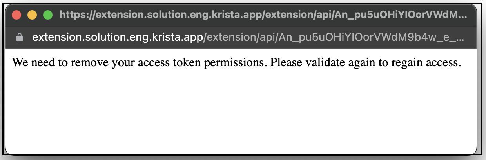

# Authentication

## Overview

The Google Calendar Extension supports two authentication modes to provide flexibility in how calendar operations are performed. Understanding these modes is crucial for proper extension configuration and usage.

## Authentication Modes

### Service Account Authentication

Service account authentication uses a single, centralized Google account configured during extension setup. This mode is ideal for automated workflows and system-level operations.

#### When to Use Service Account

- **Automated Workflows**: Background processes that don't require user interaction
- **Centralized Management**: Single point of control for calendar operations
- **System Operations**: Accessing shared calendars or managing organization-wide events
- **Batch Processing**: Bulk operations across multiple calendars

#### Configuration

To use service account authentication:

1. **Uncheck** the **"Have people authenticate with their account"** checkbox in your Krista workflow
2. The extension will use the account configured in the extension setup
3. All operations will be performed as the service account


#### How It Works

1. Extension uses the OAuth credentials configured in setup
2. Operations are performed using the service account's refresh token
3. Calendar access is limited to:
   - The service account's own calendar
   - Calendars explicitly shared with the service account
   - Organization calendars (with domain-wide delegation)

#### Permissions Required

For service account to access other users' calendars:

- **Calendar Sharing**: Users must share their calendars with the service account email
- **Domain-Wide Delegation**: For Google Workspace, configure domain-wide delegation to access all user calendars
- **OAuth Scope**: `https://www.googleapis.com/auth/calendar`
- **Grant Type**: `authorization_code` (initial authentication), `refresh_token` (token refresh)

#### Limitations

- Cannot access private calendars unless explicitly shared
- Requires domain-wide delegation for organization-wide access
- All operations appear as performed by the service account
- Limited to calendars the service account has access to

### User Account Authentication

User account authentication requires each user to authenticate with their own Google account. This mode provides personalized access and maintains user identity in calendar operations.

#### When to Use User Account

- **Personal Calendars**: Users managing their own calendar events
- **User-Specific Operations**: Operations that should reflect individual user identity
- **Interactive Applications**: User-facing applications requiring personal authentication
- **Compliance**: When audit trails must show individual user actions

#### Configuration

To use user account authentication:

1. **Check** the **"Have people authenticate with their account"** checkbox in your Krista workflow
2. Each user will be prompted to authenticate with their Google account
3. Operations will be performed as the authenticated user


#### How It Works

1. User initiates a calendar operation
2. If not authenticated, user is prompted to sign in with Google
3. User grants calendar permissions via OAuth consent screen
4. Extension stores user's refresh token securely
5. Subsequent operations use the user's credentials
6. Each user has their own authentication context

#### Permissions Required

- User must have a Google account
- User must grant calendar permissions during OAuth flow
- User must have access to the calendars they want to manage

#### Benefits

- **Personal Access**: Users access only their own calendars
- **Identity Preservation**: Operations show the actual user who performed them
- **Security**: Each user's credentials are isolated
- **Granular Control**: Users can revoke access individually

## Authentication Flow

### Initial Authentication

#### Step 1: Trigger Authentication

When a user attempts a calendar operation without authentication:

1. Extension detects missing or invalid credentials
2. Returns a `MustAuthorizeException`
3. User is prompted to authenticate

#### Step 2: OAuth Consent Screen

1. User is redirected to Google's OAuth consent screen
2. Consent screen displays:
   - Application name (from Google Cloud Console)
   - Requested permissions (Google Calendar access)
   - User's Google account selection
3. User reviews and grants permissions

#### Step 3: Authorization Code Exchange

1. Google redirects back to the extension's callback URL with an authorization code
2. Extension receives the authorization code
3. Extension makes a token request to Google's OAuth 2.0 token endpoint:
   - **Grant Type**: `authorization_code`
   - **Code**: The authorization code received
   - **Client ID**: From extension configuration
   - **Client Secret**: From extension configuration
   - **Redirect URI**: The callback URL
4. Google responds with:
   - **Access Token**: Short-lived token for API requests (expires in 1 hour)
   - **Refresh Token**: Long-lived token for obtaining new access tokens
   - **Token Type**: `Bearer`
   - **Expires In**: 3600 seconds (1 hour)
   - **Scope**: `https://www.googleapis.com/auth/calendar`
5. Tokens are stored securely in Krista's token store

#### Step 4: Token Storage

- **Refresh Token**: Stored permanently for long-term access (does not expire unless revoked)
- **Access Token**: Temporary, expires after 1 hour, refreshed automatically when expired
- **User Context**: Tokens are associated with the user's identity
- **Encryption**: All tokens are encrypted at rest in Krista's secure storage

### Token Refresh

The extension automatically handles token refresh using the OAuth 2.0 refresh token flow:

1. **Access Token Expiration**: Access tokens expire after 1 hour (3600 seconds)
2. **Automatic Detection**: Extension detects expired tokens when API requests return 401 Unauthorized
3. **Refresh Token Request**: Extension makes a token refresh request to Google's OAuth 2.0 token endpoint:
   - **Grant Type**: `refresh_token`
   - **Refresh Token**: The stored refresh token
   - **Client ID**: From extension configuration
   - **Client Secret**: From extension configuration
4. **New Access Token**: Google responds with:
   - **Access Token**: New access token (valid for 1 hour)
   - **Token Type**: `Bearer`
   - **Expires In**: 3600 seconds (1 hour)
   - **Scope**: `https://www.googleapis.com/auth/calendar`
   - **Note**: Refresh token is NOT returned (original refresh token remains valid)
5. **Token Update**: New access token is stored and used for subsequent requests
6. **Seamless Operation**: Operation continues automatically without user interaction

### Re-authentication

Users may need to re-authenticate if:

- **Refresh Token Revoked**: User revoked access from Google Account settings
- **Refresh Token Expired**: Refresh token expired due to inactivity (6 months for unverified apps, no expiry for verified apps)
- **Password Change**: User changed their Google account password
- **Security Policies**: Organization security policies require re-authentication
- **Token Manually Removed**: Administrator removed the token from Krista
- **Account Suspended**: Google account was suspended or disabled
- **Scope Changes**: Application requests additional permissions

## Authentication Setup

### For Service Account

1. **Configure Extension**:
   - Navigate to extension setup
   - Enter Client ID and Client Secret
   - Enter service account email address
   - Save configuration

2. **Authenticate Service Account**:
   - Go to **Authentication** tab in extension
   - Click **Authenticate** or **Sign in with Google**
   - Sign in with the service account credentials
   - Grant calendar permissions
   - Confirm successful authentication

3. **Configure Calendar Access** (if accessing other calendars):
   - Share calendars with service account email, OR
   - Configure domain-wide delegation in Google Workspace

### For User Account

1. **Configure Extension**:
   - Same as service account setup
   - Ensure redirect URI is configured in Google Cloud Console

2. **Enable User Authentication in Workflow**:
   - Check **"Have people authenticate with their account"**
   - Save workflow configuration

3. **User Authentication** (per user):
   - User executes workflow
   - Prompted to authenticate on first use
   - Signs in with their Google account
   - Grants calendar permissions
   - Authentication persists for future operations

## Managing Authentication

### Viewing Authentication Status

In the extension's **Authentication** tab:

- **Service Account**: Shows authentication status of the configured account
- **User Accounts**: Lists authenticated users and their status

### Removing Authentication

To remove authentication tokens:

1. Navigate to **Authentication** tab
2. Locate the user or service account
3. Click **Remove Token** or **Revoke Access**
4. Confirm the action



### Token Expiration

The extension manages token expiration automatically with different expiration policies for different token types:

#### Access Token Expiration

- **Lifetime**: 1 hour (3600 seconds)
- **Expiration Behavior**: Expires exactly 1 hour after issuance
- **Refresh Mechanism**: Automatically refreshed using refresh token
- **User Impact**: None - refresh happens transparently
- **Frequency**: Refreshed on-demand when expired
- **Error Handling**: 401 Unauthorized triggers automatic refresh

#### Refresh Token Expiration

Refresh tokens have different expiration policies based on application verification status:

**For Unverified Applications** (Testing/Development):
- **Lifetime**: 6 months of inactivity
- **Expiration Trigger**: No API calls made for 6 consecutive months
- **Renewal**: Each API call resets the 6-month timer
- **User Impact**: Must re-authenticate after 6 months of inactivity
- **Best Practice**: Use application regularly or verify the app

**For Verified Applications** (Production):
- **Lifetime**: No expiration (indefinite)
- **Expiration Trigger**: Only manual revocation or security events
- **Renewal**: Not required
- **User Impact**: One-time authentication (unless revoked)
- **Best Practice**: Complete Google's verification process for production

**Refresh Token Revocation Scenarios**:
1. **User Revocation**: User manually revokes access from Google Account settings
2. **Password Change**: User changes Google account password (may revoke tokens)
3. **Security Event**: Google detects suspicious activity
4. **Token Limit**: User exceeds maximum number of refresh tokens (50 per user per client)
5. **Account Suspension**: Google account is suspended or disabled
6. **Admin Action**: Google Workspace admin revokes access

#### Token Expiration Handling

The extension handles token expiration with the following flow:

1. **Access Token Expired**:
   - API request returns 401 Unauthorized
   - Extension automatically uses refresh token to get new access token
   - Request is retried with new access token
   - User experiences no interruption

2. **Refresh Token Expired/Revoked**:
   - Refresh token request fails
   - Extension throws `MustAuthorizeException`
   - User is prompted to re-authenticate
   - User completes OAuth flow again
   - New access and refresh tokens are issued

3. **Both Tokens Invalid**:
   - Extension detects invalid credentials
   - User must re-authenticate completely
   - Previous tokens are removed
   - Fresh authentication flow is initiated

### Revoking Access

Users can revoke access from Google:

1. Go to [Google Account Permissions](https://myaccount.google.com/permissions)
2. Locate the Krista Google Calendar application
3. Click **Remove Access**
4. User will need to re-authenticate in Krista

## OAuth 2.0 Scopes and Permissions

### Required Scope

The Google Calendar Extension requires the following OAuth 2.0 scope:

- **Scope**: `https://www.googleapis.com/auth/calendar`
- **Permission Level**: Full access to Google Calendar
- **Allows**:
  - Read calendar events
  - Create new events
  - Update existing events
  - Delete events
  - Manage attendees
  - Access calendar settings
  - Manage calendar sharing (limited)

### Scope Authorization

During the OAuth consent screen, users will see:

**Permission Request**: "See, edit, share, and permanently delete all the calendars you can access using Google Calendar"

**What This Means**:
- The extension can perform all calendar operations on behalf of the user
- Access is limited to calendars the user has access to
- The extension cannot access other Google services (Gmail, Drive, etc.)
- Users can revoke this permission at any time

### Alternative Scopes (Not Used)

The extension does NOT use these more restrictive scopes:

- `https://www.googleapis.com/auth/calendar.readonly` - Read-only access (insufficient for creating/updating events)
- `https://www.googleapis.com/auth/calendar.events` - Events only (insufficient for some operations)
- `https://www.googleapis.com/auth/calendar.settings.readonly` - Settings only (insufficient)

**Why Full Calendar Scope?**
- The extension needs to create, update, and delete events
- Managing attendees requires full calendar access
- Some operations require calendar metadata access
- Using a single scope simplifies permission management

## OAuth 2.0 Grant Types

The extension uses two OAuth 2.0 grant types during the authentication lifecycle:

### Authorization Code Grant

**Used For**: Initial user authentication

**Flow**:
1. User clicks "Authenticate" or "Sign in with Google"
2. User is redirected to Google's OAuth consent screen
3. User grants calendar permissions
4. Google redirects back with an authorization code
5. Extension exchanges code for tokens using:
   - **Grant Type**: `authorization_code`
   - **Code**: The authorization code
   - **Client ID**: Application identifier
   - **Client Secret**: Application secret
   - **Redirect URI**: Callback URL
6. Google responds with access token and refresh token

**Token Request Example**:
```
POST https://oauth2.googleapis.com/token
Content-Type: application/x-www-form-urlencoded

grant_type=authorization_code
&code={authorization_code}
&client_id={client_id}
&client_secret={client_secret}
&redirect_uri={redirect_uri}
```

**Response**:
```json
{
  "access_token": "ya29.a0AfH6SMBx...",
  "refresh_token": "1//0gL3qKZ9D...",
  "token_type": "Bearer",
  "expires_in": 3600,
  "scope": "https://www.googleapis.com/auth/calendar"
}
```

### Refresh Token Grant

**Used For**: Obtaining new access tokens when expired

**Flow**:
1. Access token expires (after 1 hour)
2. Extension detects 401 Unauthorized error
3. Extension requests new access token using:
   - **Grant Type**: `refresh_token`
   - **Refresh Token**: The stored refresh token
   - **Client ID**: Application identifier
   - **Client Secret**: Application secret
4. Google responds with new access token (refresh token NOT returned)
5. Extension updates stored access token
6. Original request is retried with new access token

**Token Request Example**:
```
POST https://oauth2.googleapis.com/token
Content-Type: application/x-www-form-urlencoded

grant_type=refresh_token
&refresh_token={refresh_token}
&client_id={client_id}
&client_secret={client_secret}
```

**Response**:
```json
{
  "access_token": "ya29.a0AfH6SMBx...",
  "token_type": "Bearer",
  "expires_in": 3600,
  "scope": "https://www.googleapis.com/auth/calendar"
}
```

**Note**: The refresh token is NOT returned in the response. The original refresh token remains valid and should continue to be used.

### Grant Type Comparison

| Aspect | Authorization Code | Refresh Token |
|--------|-------------------|---------------|
| **When Used** | Initial authentication | Token refresh |
| **User Interaction** | Required (OAuth consent) | Not required (automatic) |
| **Input** | Authorization code | Refresh token |
| **Output** | Access + Refresh tokens | Access token only |
| **Frequency** | Once per authentication | Every ~1 hour |
| **Expiration** | Code expires in 10 minutes | Refresh token long-lived |

## Security Best Practices

### Token Security

- **Encryption**: All tokens are encrypted at rest
- **Isolation**: User tokens are isolated from each other
- **Secure Storage**: Tokens stored in Krista's secure token store
- **No Logging**: Tokens are never logged or exposed

### Access Control

- **Principle of Least Privilege**: Grant only necessary calendar permissions
- **Regular Audits**: Review authenticated users periodically
- **Revoke Unused Access**: Remove tokens for inactive users
- **Monitor Activity**: Review calendar operation logs

### OAuth Best Practices

- **Verified Application**: Use verified OAuth consent screen for production
- **Minimal Scopes**: Request only Google Calendar scope
- **Secure Redirect URIs**: Use HTTPS for redirect URIs
- **Client Secret Protection**: Never expose client secret publicly

## Troubleshooting Authentication

### "Must Authorize" Error

**Symptom**: User receives "You must authorize" error

**Causes**:
- User has not authenticated
- Refresh token expired or revoked
- User changed Google password
- Token was manually removed

**Solution**:
1. Navigate to Authentication tab
2. Click **Authenticate** or **Sign in with Google**
3. Complete OAuth flow
4. Retry the operation

### "Invalid Credentials" Error

**Symptom**: Authentication fails with invalid credentials

**Causes**:
- Incorrect Client ID or Client Secret
- OAuth credentials revoked or deleted
- Redirect URI mismatch

**Solution**:
1. Verify Client ID and Client Secret in extension setup
2. Check redirect URI in Google Cloud Console
3. Ensure OAuth credentials are active
4. Regenerate credentials if necessary

### "Access Denied" Error

**Symptom**: User cannot access calendar after authentication

**Causes**:
- User denied calendar permissions
- Google Calendar API not enabled
- Account lacks calendar access

**Solution**:
1. Re-authenticate and grant all requested permissions
2. Verify Google Calendar API is enabled in Google Cloud Console
3. Check user has access to their Google Calendar

### "Redirect URI Mismatch" Error

**Symptom**: OAuth flow fails with redirect URI error

**Causes**:
- Redirect URI not configured in Google Cloud Console
- URI doesn't match exactly

**Solution**:
1. Copy exact redirect URI from Krista extension details
2. Add to Authorized redirect URIs in Google Cloud Console
3. Ensure protocol (https), domain, and path match exactly

## Domain-Wide Delegation (Advanced)

For Google Workspace organizations, domain-wide delegation allows a service account to access all users' calendars without individual sharing.

### Prerequisites

- Google Workspace account (not available for personal Gmail)
- Super Admin access to Google Workspace
- Service account created in Google Cloud Console

### Configuration Steps

1. **Create Service Account**:
   - In Google Cloud Console, create a service account
   - Note the service account's unique ID

2. **Enable Domain-Wide Delegation**:
   - In service account settings, enable domain-wide delegation
   - Note the Client ID

3. **Configure in Google Workspace Admin**:
   - Go to Google Workspace Admin Console
   - Navigate to **Security** > **API Controls** > **Domain-wide Delegation**
   - Add the service account's Client ID
   - Add scope: `https://www.googleapis.com/auth/calendar`
   - Authorize

4. **Configure Extension**:
   - Use service account email in extension setup
   - Authenticate with service account
   - Extension can now access all users' calendars

### Use Cases

- Organization-wide calendar management
- Automated scheduling across departments
- Calendar analytics and reporting
- Bulk calendar operations

## Related Documentation

- [Extension Configuration](pages/ExtensionConfiguration.md) - Configure OAuth credentials
- [Creating Google App](pages/CreatingGoogleApp.md) - Setup Google Cloud project
- [Get Events for User](pages/GetEventsForUser.md) - Accessing other users' calendars
