# Creating Google App

## Overview

To use the Google Calendar Extension, you need to create and configure a Google Cloud project with OAuth 2.0 credentials. This guide provides step-by-step instructions for setting up your Google Cloud application.

## Prerequisites

- A Google account (Gmail or Google Workspace)
- Access to [Google Cloud Console](https://console.cloud.google.com/)
- Administrative permissions to create projects (for organizations)

## Step-by-Step Guide

### Step 1: Access Google Cloud Console

1. Navigate to [Google Cloud Console](https://console.cloud.google.com/getting-started)
2. Sign in with your Google account
3. If this is your first time, you may need to accept the Terms of Service

### Step 2: Create a New Project

1. Click on the **project selector** at the top left of the page
   
   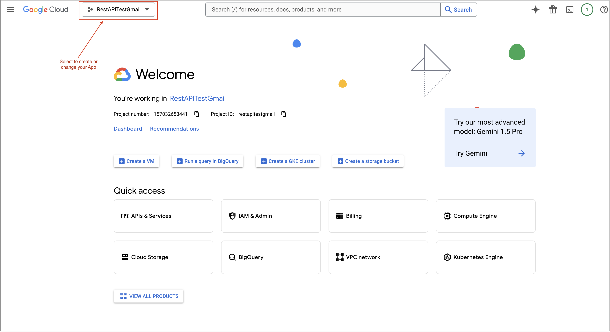

2. In the popup window:
   - If you have existing projects, they will be listed
   - Click **NEW PROJECT** to create a new one
   
   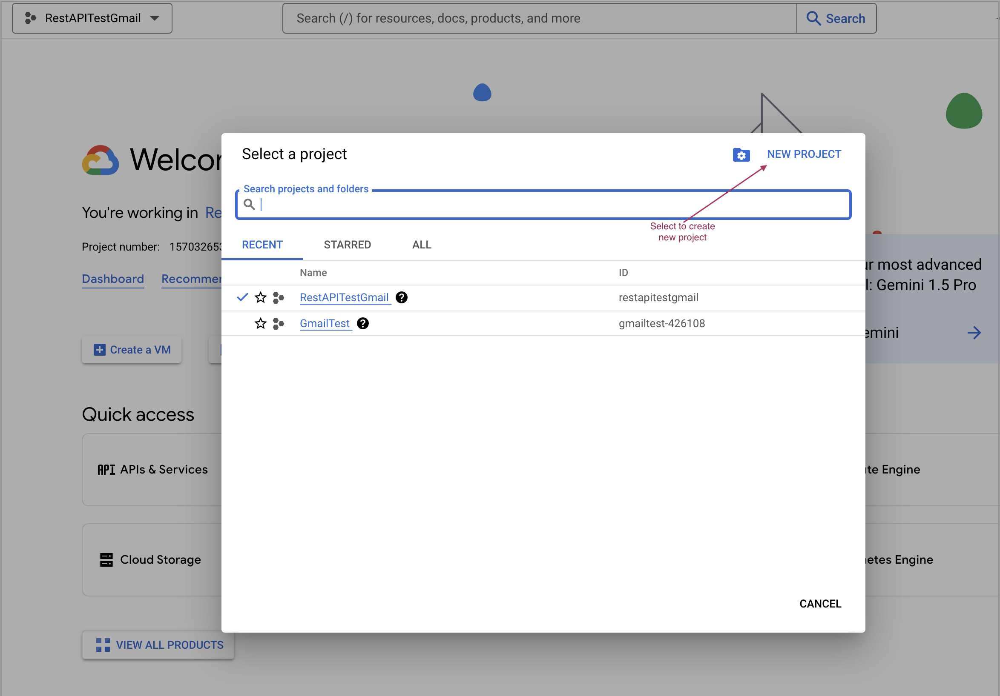

3. Configure your new project:
   - **Project Name**: Enter a descriptive name (e.g., "Krista Calendar Integration")
   - **Organization**: Select your organization (if applicable)
   - **Location**: Choose the appropriate location
   - Click **CREATE**
   
   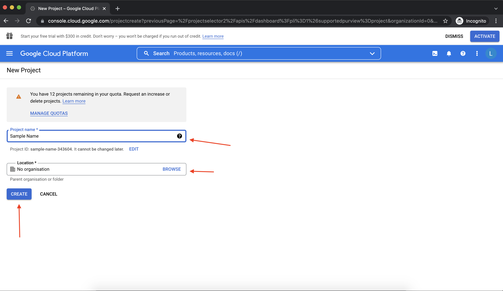

4. Wait for the project to be created (this may take a few seconds)
5. Select your newly created project from the project selector

### Step 3: Enable Google Calendar API

1. In the left sidebar, click on **APIs & Services**
   
   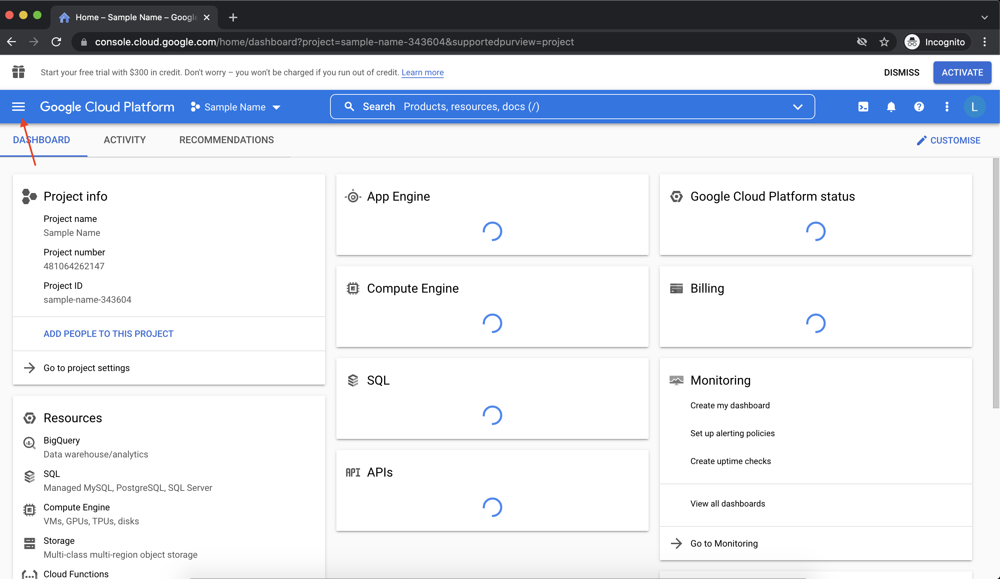

2. Click on **Enabled APIs and services** or **Library**
   
   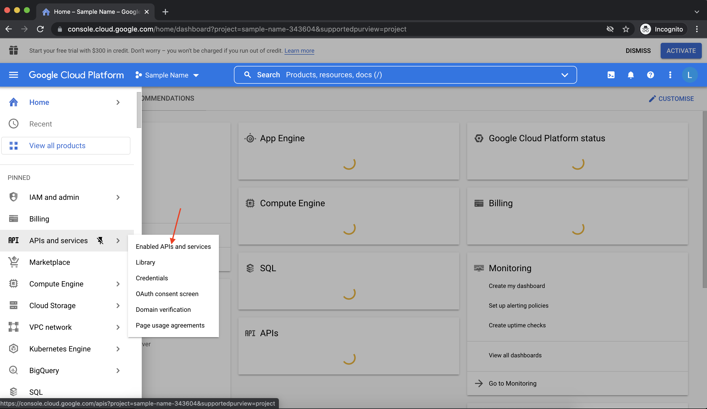

3. Click **+ ENABLE APIS AND SERVICES** at the top
   
   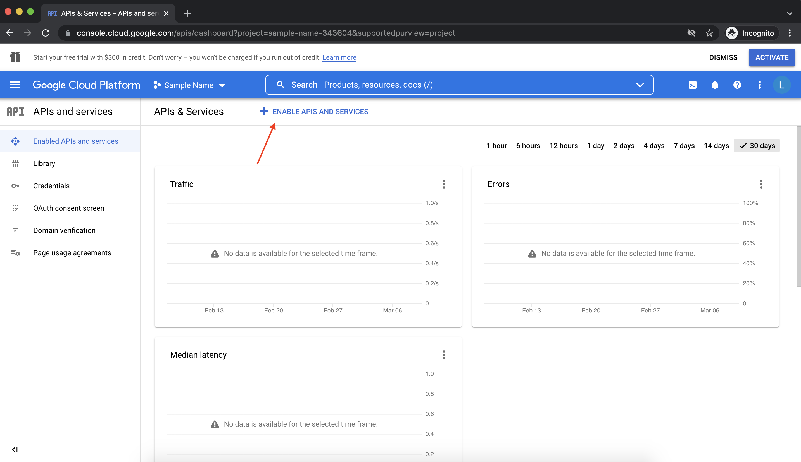

4. Search for "Google Calendar API"
5. Click on **Google Calendar API** from the results
6. Click **ENABLE**
   
   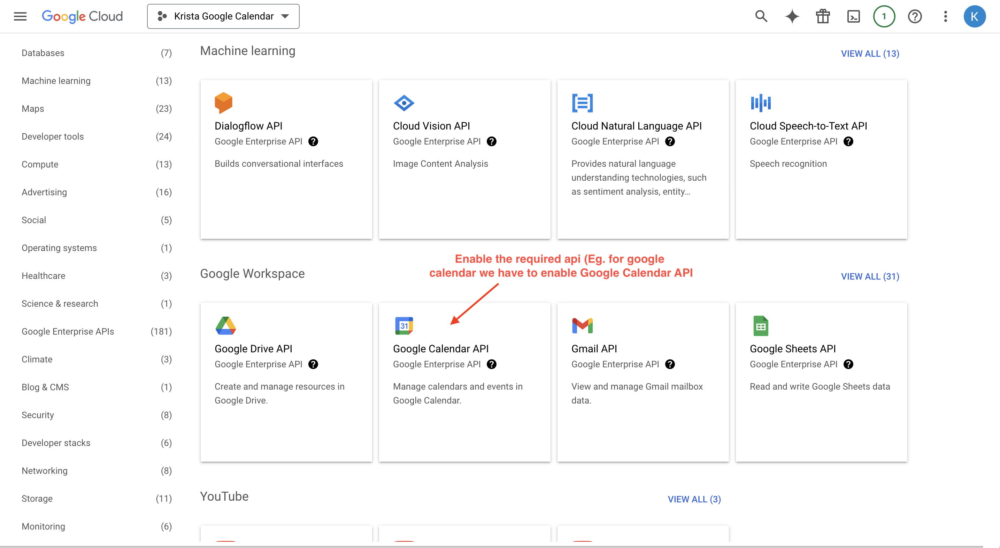

7. Wait for the API to be enabled

### Step 4: Configure OAuth Consent Screen

The OAuth consent screen is what users see when they authenticate with your application.

1. Navigate to **APIs & Services** > **Credentials**
   
   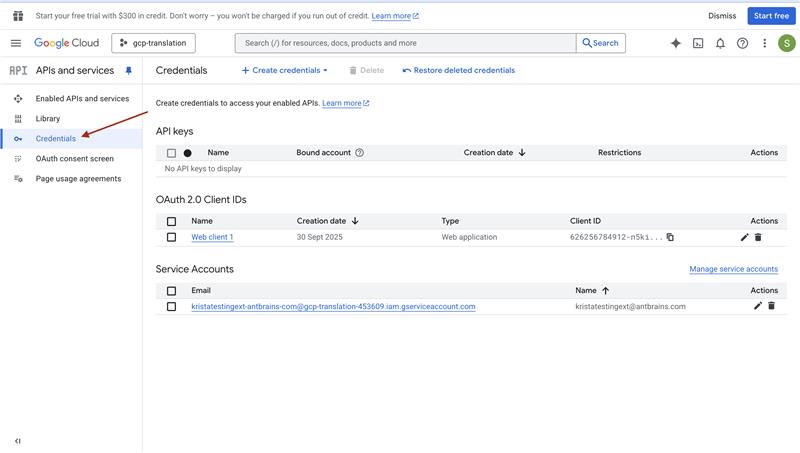

2. Click **CONFIGURE CONSENT SCREEN**
   
   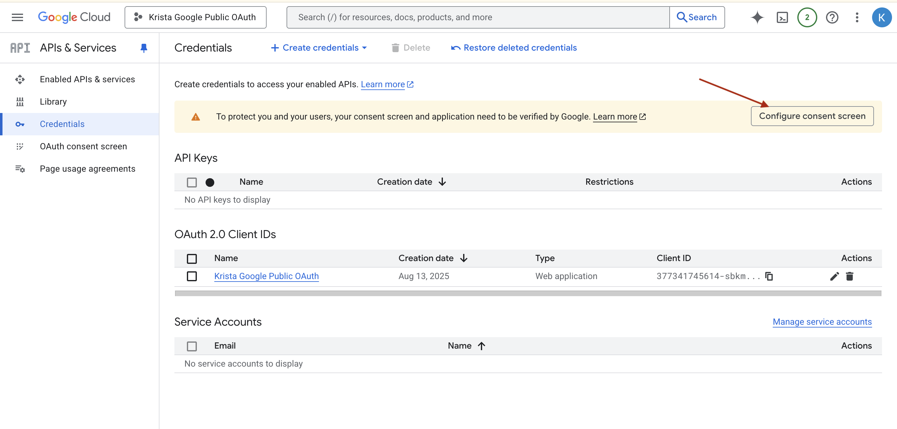

3. Select **User Type**:
   - **Internal**: For Google Workspace organizations (users within your organization only)
   - **External**: For public applications (any Google account)
   
   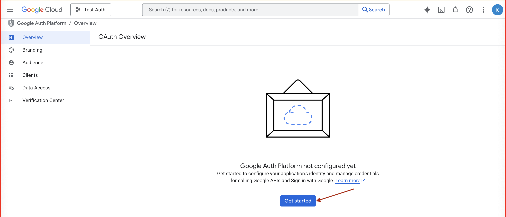

4. Click **CREATE**

#### OAuth Consent Screen Configuration

##### App Information

Provide the following information:

- **App name**: Name displayed to users (e.g., "Krista Calendar Integration")
- **User support email**: Email for user support inquiries
- **App logo** (optional): Upload a logo for your application
- **Application home page** (optional): URL to your application's homepage
- **Application privacy policy link** (optional): URL to privacy policy
- **Application terms of service link** (optional): URL to terms of service

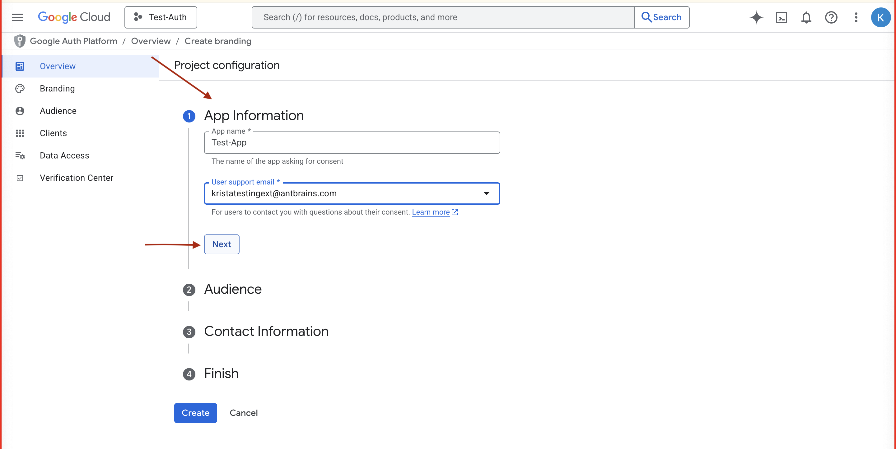
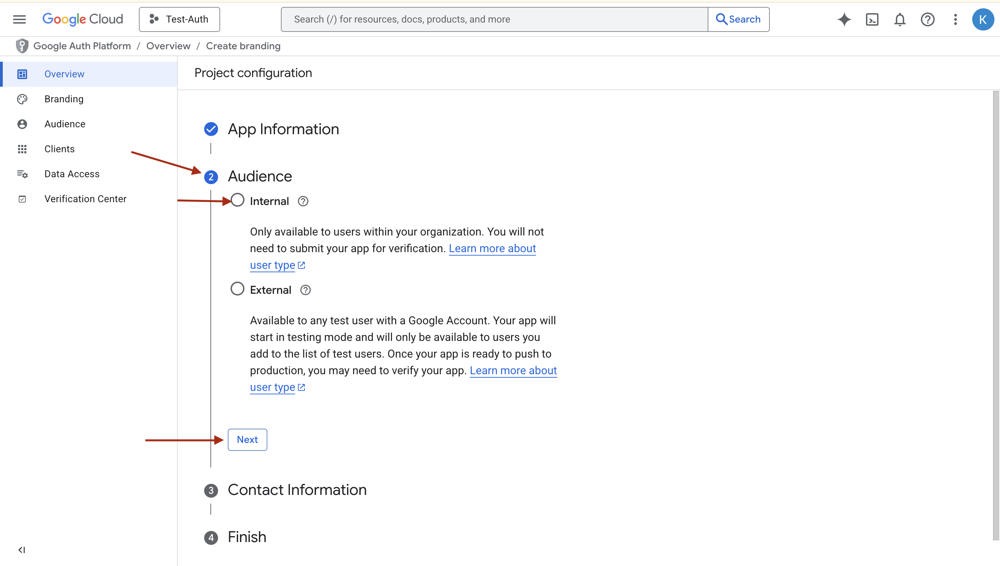

##### App Domain

- **Authorized domains**: Add your Krista instance domain (e.g., `krista.com`)

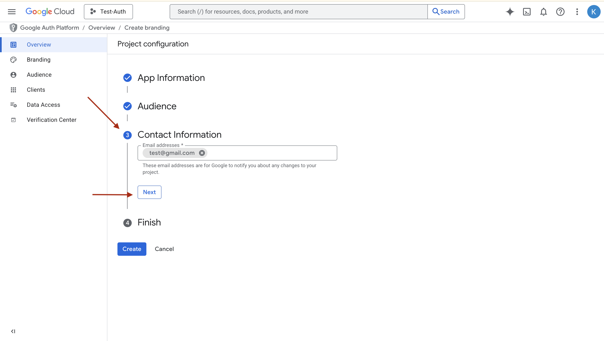

##### Developer Contact Information

- **Developer contact information**: Email addresses for Google to contact you

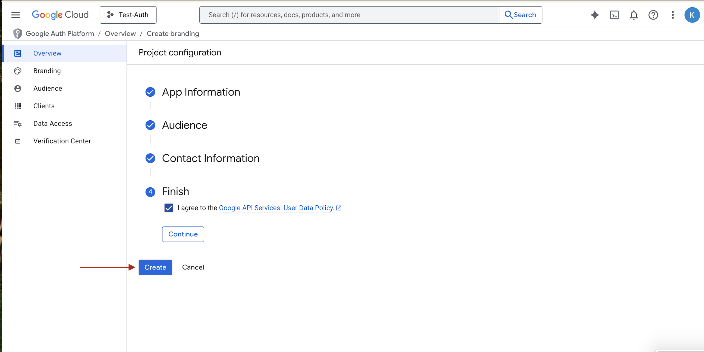

Click **SAVE AND CONTINUE**

### Step 5: Configure Scopes

Scopes define what permissions your application requests from users.

1. On the **Scopes** page, click **ADD OR REMOVE SCOPES**

2. Search for "Google Calendar API" or scroll to find it

3. Select the following scope:
   - **Google Calendar API** - `https://www.googleapis.com/auth/calendar`
   - Description: "See, edit, share, and permanently delete all the calendars you can access using Google Calendar"

   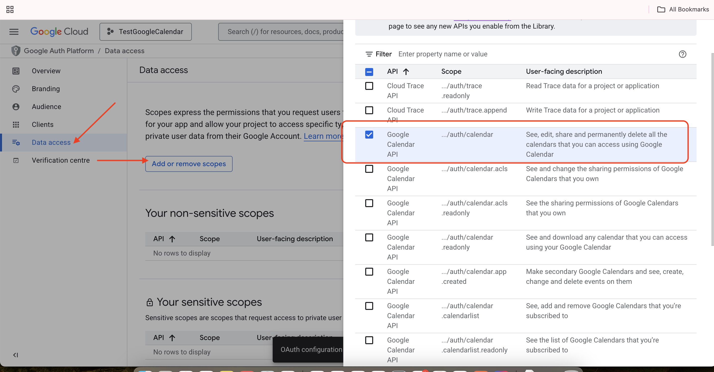

4. Click **UPDATE** to save the scopes

   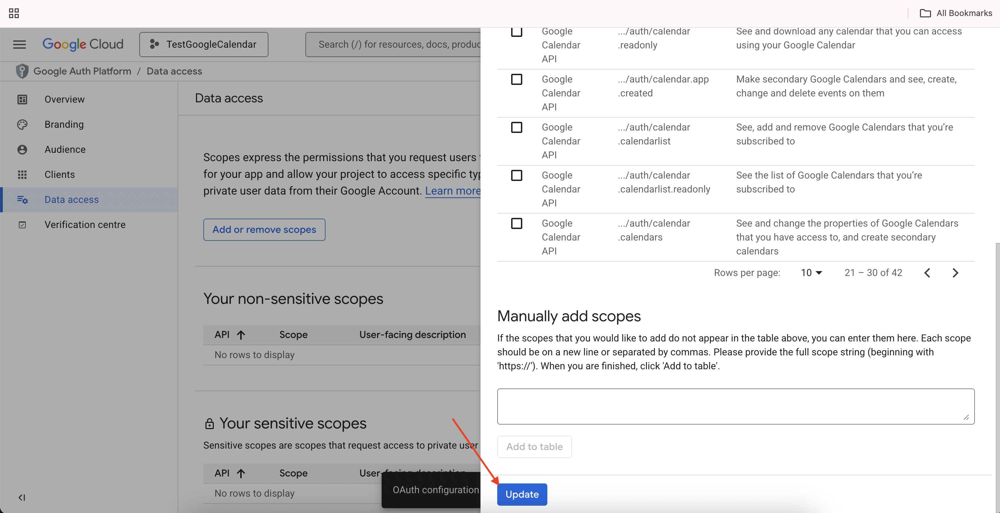

5. Click **SAVE AND CONTINUE**

   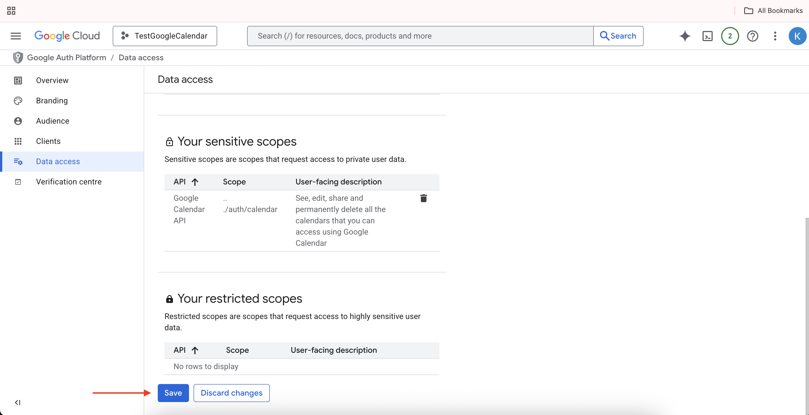

### Step 6: Add Test Users (For External Apps in Testing)

If you selected "External" user type and your app is in testing mode:

1. Click **ADD USERS**
2. Enter email addresses of users who should have access during testing
3. Click **ADD**
4. Click **SAVE AND CONTINUE**

> **Note**: Apps in testing mode are limited to 100 test users. To remove this limitation, submit your app for verification.

### Step 7: Create OAuth 2.0 Credentials

1. Navigate to the **Overview** tab or **Credentials** page

2. Click **+ CREATE CREDENTIALS** at the top

3. Select **OAuth client ID**

   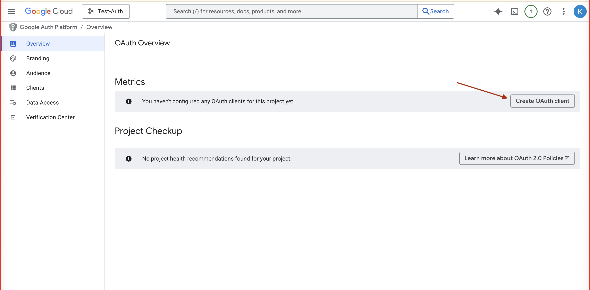

4. Configure the OAuth client:

   **Application Type**: Select **Web application**

   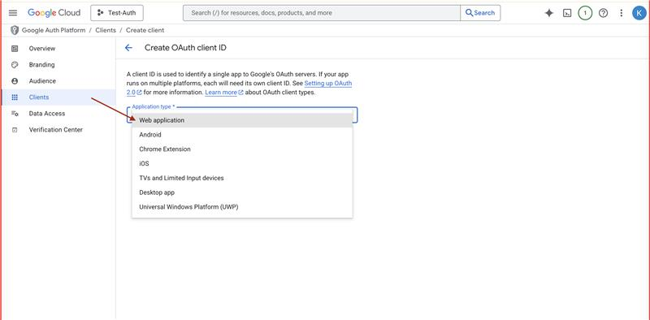

   **Name**: Enter a descriptive name (e.g., "Krista Calendar Extension")

   **Authorized JavaScript origins** (optional): Add your Krista instance URL
   - Example: `https://your-krista-instance.com`

   **Authorized redirect URIs**: Add the callback URL from your Krista extension
   - Format: `[ROUTING_ID]/rest/googlecalendar/callback`
   - Example: `https://your-krista-instance.com/extension/api/v1/abc123/rest/googlecalendar/callback`
   - To get the Routing ID:
     1. Go to your Krista extension details page
     2. Copy the Routing ID
     3. Append `/rest/googlecalendar/callback`

   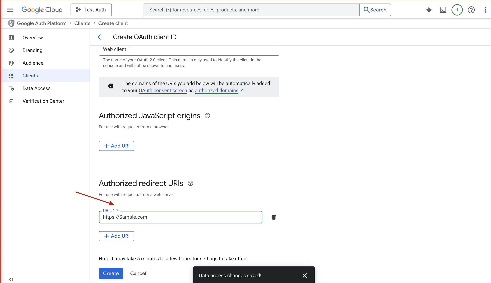

5. Click **CREATE**

### Step 8: Save OAuth Credentials

After creating the OAuth client, a popup will display your credentials:

1. **Client ID**: Copy and save this value
   - Format: `[PROJECT_ID].apps.googleusercontent.com`
   - Example: `123456789-abc123def456.apps.googleusercontent.com`

2. **Client Secret**: Copy and save this value
   - Format: `GOCSPX-[SECRET_STRING]`
   - **Important**: Keep this secret secure and never share it publicly

3. Click **OK** to close the popup

> **Security Note**: Store these credentials securely. You can always retrieve the Client ID later, but the Client Secret should be saved immediately.

### Step 9: Configure Extension in Krista

Now that you have your OAuth credentials, configure the Krista extension:

1. Navigate to your Krista workspace
2. Go to **Extensions** > **Google Calendar Extension**
3. Click **Setup** or **Configure**
4. Enter the following:
   - **Client ID**: Paste the Client ID from Step 8
   - **Client Secret**: Paste the Client Secret from Step 8
   - **Email**: Enter the email address of the Google account (the one used to create the project)
   - **Auth Type**: Select **Private**
5. Click **Save**

For detailed configuration instructions, see [Extension Configuration](pages/ExtensionConfiguration.md).

### Step 10: Authenticate

After configuring the extension:

1. Go to the **Authentication** tab in the extension
2. Click **Authenticate** or **Sign in with Google**
3. You'll be redirected to Google's OAuth consent screen
4. Review the requested permissions
5. Click **Allow** to grant calendar access
6. You'll be redirected back to Krista
7. Confirm successful authentication

For detailed authentication instructions, see [Authentication](pages/Authentication.md).

## Additional Configuration

### Publishing Your App (Optional)

If you want to remove the "unverified app" warning and increase user limits:

1. Navigate to **OAuth consent screen**
2. Click **PUBLISH APP**
3. For apps requesting sensitive scopes (like Calendar), you'll need to submit for verification:
   - Click **PREPARE FOR VERIFICATION**
   - Complete the verification questionnaire
   - Provide required documentation
   - Submit for review

**Verification Timeline**: Google's verification process can take several weeks.

### Managing Credentials

#### Viewing Credentials

1. Navigate to **APIs & Services** > **Credentials**
2. Your OAuth 2.0 Client IDs are listed under **OAuth 2.0 Client IDs**
3. Click on a credential to view or edit it

#### Regenerating Client Secret

If your Client Secret is compromised:

1. Navigate to **Credentials**
2. Click on your OAuth 2.0 Client ID
3. Click **RESET SECRET**
4. Confirm the action
5. Copy the new Client Secret
6. Update the Krista extension configuration with the new secret

#### Deleting Credentials

To delete OAuth credentials:

1. Navigate to **Credentials**
2. Click the trash icon next to the credential
3. Confirm deletion
4. **Warning**: This will break existing integrations using these credentials

### Monitoring API Usage

1. Navigate to **APIs & Services** > **Dashboard**
2. View API usage metrics:
   - Requests per day
   - Errors
   - Latency
3. Click on **Google Calendar API** for detailed metrics

### Setting Quotas and Limits

1. Navigate to **APIs & Services** > **Google Calendar API** > **Quotas**
2. View current quota limits:
   - Queries per day: 1,000,000 (default)
   - Queries per 100 seconds per user: 20,000 (default)
3. Request quota increases if needed

## Troubleshooting

### "API Not Enabled" Error

**Solution**: Ensure Google Calendar API is enabled in your project
1. Go to **APIs & Services** > **Library**
2. Search for "Google Calendar API"
3. Click **ENABLE**

### "Redirect URI Mismatch" Error

**Solution**: Verify redirect URI configuration
1. Check the exact redirect URI in Krista extension details
2. Ensure it's added to **Authorized redirect URIs** in Google Cloud Console
3. URIs must match exactly (including protocol, domain, and path)

### "Access Denied" Error

**Solution**: Check OAuth consent screen configuration
1. Ensure the user's email is added to test users (for external apps in testing)
2. Verify the app is published or the user is a test user
3. Check that Google Calendar scope is added

### "Invalid Client" Error

**Solution**: Verify OAuth credentials
1. Ensure Client ID and Client Secret are correct
2. Check that the OAuth client is for "Web application" type
3. Verify the credentials haven't been deleted or revoked

## Security Best Practices

1. **Protect Client Secret**: Never commit Client Secret to version control or share publicly
2. **Use HTTPS**: Always use HTTPS for redirect URIs in production
3. **Limit Scopes**: Only request the Google Calendar scope (don't request unnecessary permissions)
4. **Regular Audits**: Periodically review API usage and access logs
5. **Rotate Credentials**: Consider rotating Client Secret periodically for enhanced security
6. **Monitor Quotas**: Set up alerts for unusual API usage patterns

## Next Steps

After creating your Google App:

1. [Configure the Extension](pages/ExtensionConfiguration.md) with your OAuth credentials
2. [Authenticate users](pages/Authentication.md) to grant calendar access
3. Start using [catalog requests](pages/ScheduleMeeting.md) to manage calendars

## Related Documentation

- [Extension Configuration](pages/ExtensionConfiguration.md) - Configure the extension with OAuth credentials
- [Authentication](pages/Authentication.md) - Authenticate users and manage tokens
- [Google Calendar API Documentation](https://developers.google.com/calendar/api/guides/overview) - Official Google documentation

