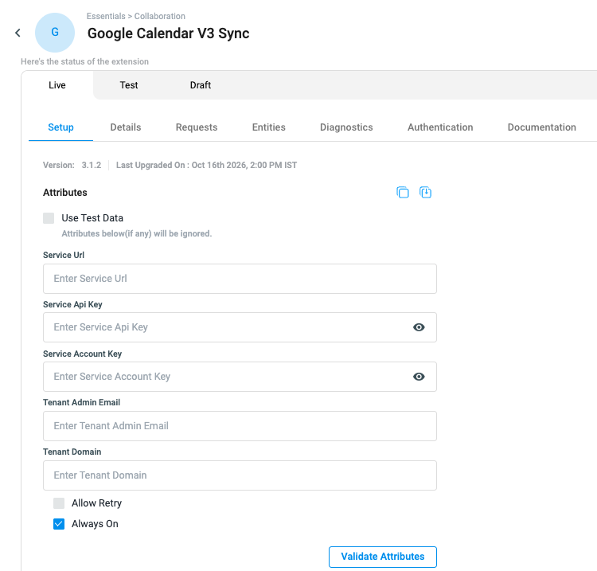

# Extension Configuration

This page describes the current **Google Calendar V3 Sync** Setup page. For Always On authorization,
screenshots, and verification, follow the [step-by-step setup guide](pages/AlwaysOnSetup.md).

## Setup fields

In Krista Studio, open the extension used by your Meeting Agent workspace, choose the appropriate
environment tab, and open **Setup**. For production, use **Live** and leave **Use Test Data** unchecked.

| Field | Purpose | Default / requirement |
|---|---|---|
| **Service Url** | CA service base URL for the environment, not the extension routing URL. | Needed for the Meeting Agent integration. |
| **Service Api Key** | Secured API key for the CA service. | Needed for the integration, including registered-user discovery. |
| **Service Account Key** | Secured field containing the entire service account JSON key, unchanged. | Needed for delegated Always On access. |
| **Tenant Admin Email** | Workspace administrator identity used for Directory lookups and validation of primary-calendar access. | Needed for delegated Always On access. |
| **Tenant Domain** | Optional domain filter for directory users and domain for Google Group expansion. | Blank searches all Workspace customer domains for users; groups use the administrator's domain. |
| **Allow Retry** | Enables catalog input-validation retry prompts. Separate from calendar discovery. | Off by default. |
| **Always On** | Uses delegated access for active Workspace accounts matching active, licensed Meeting Agent seats. Does not scan the entire tenant. | Off by default. |



The OAuth **Client ID**, **Client Secret**, **Email**, and **Auth Type** used by individual sign-in
are not additional fields on this Setup page. A per-user OAuth client cannot substitute for the
service account JSON key used by Always On.

## Choose a calendar discovery mode

- **Always On off:** users connect their own Google Calendar through the existing individual OAuth flow.
- **Always On on and configured:** the extension scans active Workspace accounts matching active,
  licensed Meeting Agent seats, even if those users have never individually connected Google Calendar.
- **Always On on but credentials or access unavailable:** no calendar is scanned until the problem is
  fixed, and the log reports `degraded=true` with the reason. Personal sign-ins are never used as a
  fallback. A saved checkbox alone does not prove delegation works.

Always On and personal sign-ins are either/or. With Always On on, calendars are read only through the
workspace's delegated access; personal sign-ins stay stored but are not used for any calendar
operation, and switching Always On off returns to them without anyone signing in again. Review
[who stops being captured](pages/AlwaysOnRegisteredUsers.md#important-who-stops-being-captured)
before changing modes. Meeting templates still govern capture and post-meeting behavior.

## Configure Always On

1. Prepare the service account, JSON key, Google Calendar API, and Admin SDK API.
2. Enter the Setup fields and select **Always On**.
3. Select **Validate Attributes** and save. With both delegation credentials present, validation
   probes Directory users and the administrator's primary calendar.
4. If authorization is needed, run **Save Configuration Google Calendar** from the setup
   conversation and complete the administrator setup link. Return to Krista and confirm saving succeeds.
5. Check `[GCAL-DISCOVERY]` for `mode=ENROLLED_USERS` and `alwaysOn=true`, then test a registered user's calendar.

Full instructions and screenshots: [Always On — Step-by-Step Setup](pages/AlwaysOnSetup.md).

### Read-only delegation scopes

A Workspace super administrator grants the service account's numeric OAuth Client ID these scopes:

```text
https://www.googleapis.com/auth/calendar.readonly
https://www.googleapis.com/auth/admin.directory.user.readonly
https://www.googleapis.com/auth/admin.directory.group.readonly
```

When entering them in Google Admin Console, separate them with commas. For an existing grant with
only the first two scopes, add the group scope to that same entry. Without it, group expansion is
skipped; initial validation does not test group expansion.

## Security and troubleshooting

Keep service keys and the service account private key in approved secure storage. Never include
them in logs, screenshots, or tickets. Always On is read-only; calendar writes continue to use the
individual user's connected account.

For degraded discovery, missing users, expired setup links, and authorization failures, see the
[setup troubleshooting checklist](pages/AlwaysOnSetup.md#troubleshooting).

To disable Always On, clear the checkbox on this Setup page, validate, and save. A conversational
save with `alwaysOn=false` does not override an already enabled Studio setting. Do not revoke the
Google grant or key without assessing other integrations using it.

## Related documentation

- [Always On — Step-by-Step Setup](pages/AlwaysOnSetup.md)
- [Always On eligibility and Google Groups](pages/AlwaysOnRegisteredUsers.md)
- [Authentication](pages/Authentication.md)
- [Creating Google App](pages/CreatingGoogleApp.md)

